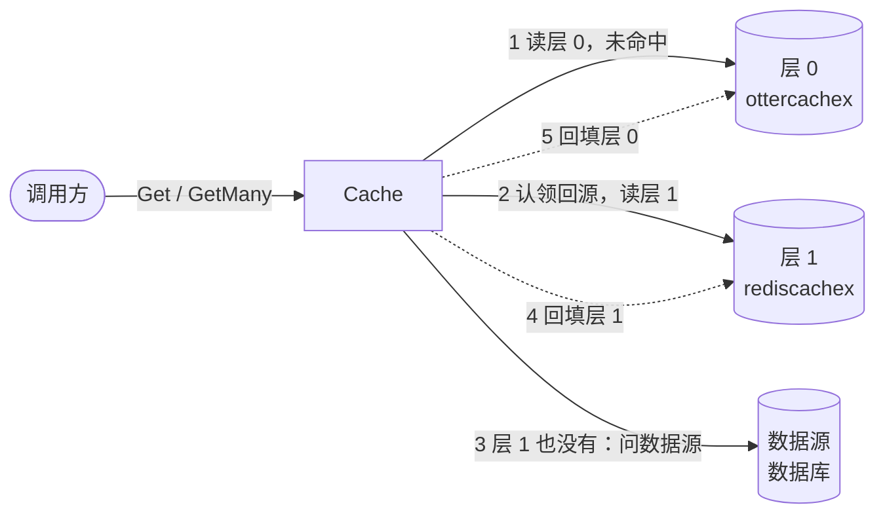
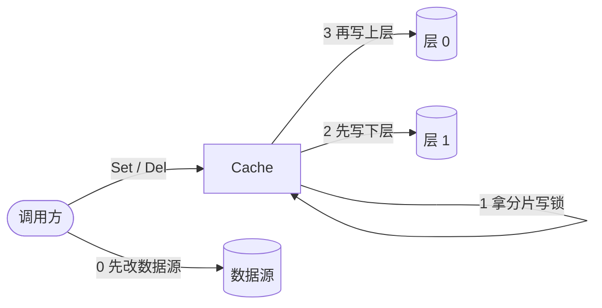

# cachex 设计总览

这里只写**现在成立**的设计。被推翻的做法直接删掉，理由放进 [ADR](adr/)。术语以 [GLOSSARY.md](../GLOSSARY.md) 为准。

## 一句话

cachex 是一个泛型的多层读穿缓存：一个缓存（`Cache[T]`）从上到下读它的各层，都没有可用条目时才问数据源；同一个 key 的并发未命中只回源一次，结果回填进上面那些没命中的层；条目分新鲜、陈旧、腐烂三态，「不存在」也作为条目记下；写入从最下层写到最上层，并保证回源不会把旧值回填到写入之后。

## 为什么需要它

直接「查缓存，没有就查数据库再回填」会遇到几类问题，cachex 分别用一个机制处理：

| 问题 | 现象 | 机制 |
|---|---|---|
| 缓存击穿 | 热点 key 腐烂的瞬间，大量请求同时打到数据源 | [合并回源](design/singleflight.md) + [二次检查](design/read-path.md#二次检查) |
| 缓存穿透 | 查询根本不存在的 key，每次都打到数据源 | [不存在记录](design/read-path.md#不存在记录) |
| 缓存雪崩 | 同时写入的大量条目在同一时刻一起腐烂 | [抖动](design/read-path.md#条目的寿命) |
| 腐烂时的等待 | 条目一腐烂，读请求就要同步等回源 | [返回陈旧值](design/read-path.md#返回陈旧值) |
| 旧值回填 | 写入刚完成，一个更早开始的回源把旧值写了回去 | [写入顺序与分片锁](design/write-order.md) |
| 多次往返 | 一次要读几百个 key，逐个回源太慢 | [批量读](design/batch.md) |

## 核心模型

```go
type Entry[T any] struct {           // 条目：后端里为一个 key 存的东西
    Value      T
    NotFound   bool                  // 不存在记录
    CachedAt   time.Time             // 数据源回答的时间
    FreshUntil time.Time             // 之后变陈旧
    ExpiresAt  time.Time             // 之后腐烂；后端用它做原生过期（按真实时钟）
}

type Backend[T any] interface {      // 后端：一层的存储，单 key 和批量方法都要有
    Get(ctx, key) (Entry[T], bool, error)
    GetMany(ctx, keys) (map[string]Entry[T], error)
    Set / SetMany / Del / DelMany
}

type ByteBackend interface {         // 字节后端：只存字节和过期时间
    Get / GetMany / Set(ctx, key, data, expiresAt) / SetMany / Del / DelMany
}
func Encoded[T any](b ByteBackend, codec Codec[T], logger *slog.Logger) Backend[T]

type Source[T any] interface { Get(ctx, key) (T, error) }                         // 数据源，不存在返回 ErrNotFound
type BatchSource[T any] interface { GetMany(ctx, keys) (map[string]T, error) }    // 可选：一次回答多个 key

func New[T any](source Source[T], layers []Layer[T], opts ...Option) *Cache[T]
func NewLayer[T any](backend Backend[T], opts ...LayerOption) Layer[T]
```

- **一个 `Cache` 管所有层**：`layers[0]` 最快、最先读，最后才是数据源。一个 key 只有一个在途回源、一套分片锁，见 [ADR 0012](adr/0012-one-cache-over-layers.md)。
- **条目由 `Cache` 计算**：用户类型只出现在 `T` 里；每层的新鲜期、陈旧期、不存在记录的寿命在 `NewLayer` 上配置，后端只负责存。
- **后端拆在子包里**：`ottercachex`（内存）、`bigcachex`（按字节存的内存）、`rediscachex`、`gormcachex`；失效广播的传输在 `rediscachex`（Redis Pub/Sub）和 `gobuscachex`（go-bus，基于 PostgreSQL）；`goquecachex` 把 gormcachex 的清理做成 go-que 上的单例定时任务；测试用的 `cachextest`。见 [backends.md](design/backends.md)。
- **多个实例之间可以打开失效广播**：`WithBroadcast` 把写过的 key 发给其他实例，它们只从本地层（后端实现了 `LocalBackend`）删掉，经过写入顺序守卫；每次订阅成功就清空本地层，兜住丢掉的消息。见 [consistency.md](design/consistency.md#失效广播)、[ADR 0023](adr/0023-invalidation-broadcast.md)。
- **共享层可以打开租约**：后端可选实现 `Leasing`（字节后端实现 `ByteLeasing`，由 `Encoded` 转发），一层未命中后领租约，写入作废它，回填只写还持有令牌的层，这样别的实例写入之后，旧值不会被回填进共享层。见 [consistency.md](design/consistency.md#租约lease)、[ADR 0020](adr/0020-leases-on-shared-layers.md)。
- **字节后端统一经 `Encoded`**：`bigcachex`、`rediscachex`、`gormcachex` 只实现 `ByteBackend`；条目的编码、解码失败当未命中、不写已经腐烂的条目，都只在 `Encoded` 里写一次，见 [ADR 0015](adr/0015-byte-backends-through-encoded.md)。

## 架构总览

下面两张图都以「内存层 → Redis 层 → 数据库」为例。

**读取的数据流**：实线是一次未命中走过的路，虚线是回填。



**写入的数据流**：编号就是先后顺序，数据源不写。



一次读取的处理顺序：

1. **读第一层**，新鲜就返回；陈旧就返回并后台刷新；腐烂或没有就往下走（[读取路径](design/read-path.md)）。
2. **合并回源**：同一个 key 只让一个请求往下走，其他请求等它的结果（[合并回源](design/singleflight.md)）。
3. 领头请求**二次检查**第一层，再**依次读下面各层**，都没有可用条目才**问数据源**。
4. **发布**结果、**回填**进上面那些层、最后**注销**在途回源（[发布与注销](design/singleflight.md#发布与注销)）；回填受写入顺序守卫保护，不会落在写入之后（[写入顺序](design/write-order.md)）。

## 配置项

`New(source, layers, opts...)` 的选项（和 godoc 一致，以 godoc 为准）：

| 选项 | 默认 | 作用 | 详见 |
|---|---|---|---|
| `WithFetchTimeout(d)` | `DefaultFetchTimeout` = 60 秒 | 回源的每一步、写入失败后的失效，各自受它限时 | [singleflight.md](design/singleflight.md#回源用的-ctx) |
| `WithGetManyConcurrency(n)` | `DefaultGetManyConcurrency` = 16 | 一次 `GetMany` 同时向数据源发出的请求数：数据源不是批量数据源时是 `Get` 调用，否则是每段一次的调用；名额不够时下一段等着 | [batch.md](design/batch.md#回源怎么发) |
| `WithGetManyChunkSize(n)` | 0（全部一段） | 一次 `GetMany`（以及多个 key 的后台刷新）每段多少个 key：一段开始时才认领，每层一次调用、问数据源、各自回填；还没开始的段不认领，并发的 `Get` 不用等它 | [batch.md](design/batch.md#回源怎么发) |
| `WithMaxAge(func(T) time.Duration)` | 不限 | 按值给条目定寿命上限，在回源拿到值时调用一次，`Set`/`SetMany` 写入值时也调用；返回 0 或负数表示不缓存；`T` 必须和 `Cache` 的一致，否则 `New` panic | [read-path.md](design/read-path.md#条目的寿命) |
| `WithBroadcast(b)` | 不开 | 失效广播：写入后把 key 发给其他实例，它们从本地层删掉；每次订阅成功清空本地层 | [consistency.md](design/consistency.md#失效广播) |
| `WithNow(f)` | `time.Now` | `Cache` 计算和判断条目所用的时钟；后端的原生过期仍按真实时钟 | [backends.md](design/backends.md#过期按真实时钟) |
| `WithLogger(l)` | `slog.Default()` | 不让调用失败的失败（回填、失效、后台刷新失败），以及回源里的 panic | — |

`NewLayer(backend, opts...)` 的选项：

| 选项 | 默认 | 作用 |
|---|---|---|
| `TTL(fresh, stale)` | 必填，`fresh` 必须大于 0 | 值的新鲜期和之后的陈旧期，从条目写进这一层时起算，不超过下层那个条目的 |
| `NotFoundTTL(fresh, stale)` | 0（这一层不记不存在） | 不存在记录的新鲜期和陈旧期 |
| `Jitter(ratio)` | `DefaultJitter` = 0.1 | 把新鲜期随机缩短最多这个比例，取值 `[0, 1)` |

下面这些都会 panic：

- `New`：数据源为 nil；超时、并发数不大于 0；分段为负；日志或时钟为 nil；`WithMaxAge` 的参数类型不是 `Cache` 的 `T`；某一层不是用 `NewLayer` 建的（零值的 `Layer`）；有 `WithBroadcast` 却没有一层是本地层（`LocalBackend`）。
- `NewLayer`：后端为 nil；没有 `TTL` 或新鲜期不大于 0；TTL 为负；新鲜期加陈旧期超过 100 年；`NotFoundTTL` 只有陈旧期没有新鲜期；抖动不在 `[0, 1)`。

`Close()` 先停止监听失效广播（如果开了），再等待它之前启动的后台工作结束：正在进行的回源和它们的回填、后台刷新、放弃等待的写入在分片空出后补做的失效和随后的广播发布；之后不再发起后台刷新。它不关闭后端，关闭之后读写照常可用，但收不到其他实例的写入了，本地层可能一直返回被覆盖的值，直到腐烂。所以关闭后端之前先调用 `Close`。设计文档里只在这里完整列出 `Close` 等什么，分篇只提一句或链接到这里；godoc、README、MIGRATION、FAQ 面向使用者各写一份，改的时候一起改。

## 分篇

| 文档 | 内容 |
|---|---|
| [design/read-path.md](design/read-path.md) | 一次 `Get` 的完整流程：条目的寿命、三态、不存在记录、返回陈旧值、二次检查、回填 |
| [design/singleflight.md](design/singleflight.md) | 合并回源：认领、发布与注销、回源 ctx 和 `WithFetchTimeout`、panic 与 Goexit、后台刷新 |
| [design/write-order.md](design/write-order.md) | 写入顺序：先写下层、分片锁、写入代数、回填保护、摘除在途回源、写入顺序守卫、失败时怎么办 |
| [design/batch.md](design/batch.md) | 批量读：流程、分段与并发、错误模型和三种结果 |
| [design/backends.md](design/backends.md) | 后端接口、字节后端与 `Encoded`、编解码、过期按真实时钟、各子包的实现要点、契约测试 |
| [design/consistency.md](design/consistency.md) | 一致性：单进程内保证什么、多实例的边界、TTL 的作用 |

## 其他文档

| 文档 | 内容 |
|---|---|
| [GLOSSARY.md](../GLOSSARY.md) | 术语表 |
| [adr/](adr/) | 架构决策记录 |
| [todo.md](todo.md) | 发现了但还没做的事 |
| [faq_ZH.md](faq_ZH.md) | 常见问题（英文版见 [faq.md](faq.md)） |
| [research/](research/README.md) | 实测与调研报告 |
| [../BENCHMARK.md](../BENCHMARK.md) | 性能基准（中英双语） |
