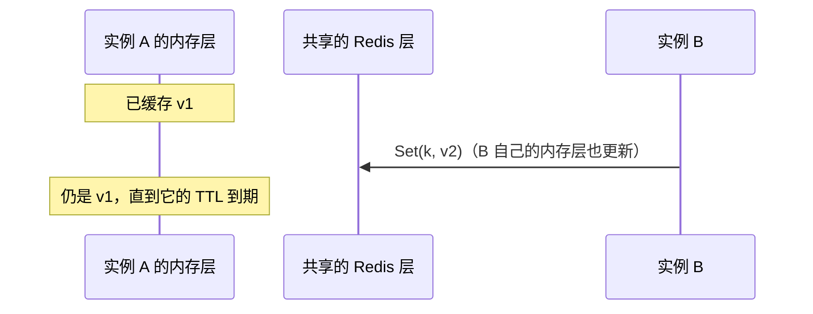
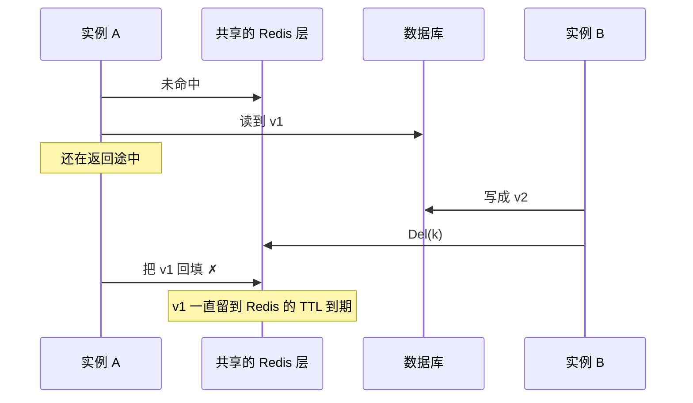
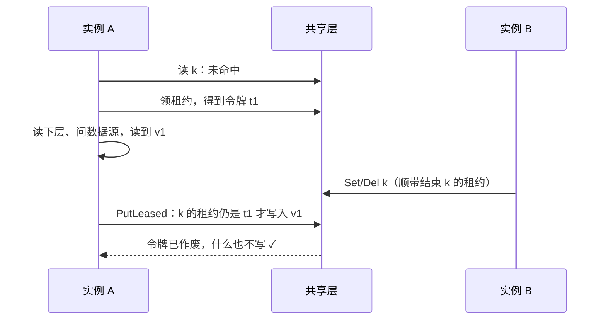

# 一致性

cachex 在**一个进程**内保证写入顺序。跨进程（多个实例共用 Redis 或数据库）时，打开了租约的共享层不会被旧值回填；打开了失效广播，其他实例的内存层在消息到达时就删掉写过的 key，消息丢了也会清空本地层兜底。这篇说明边界在哪里、租约和失效广播怎么工作、TTL 该怎么设。

## 单个进程内保证什么

前提：通过**同一个 `Cache`** 调用 `Set`/`Del`，并且先改数据源、再调用它们（见 [write-order.md](write-order.md#使用方式改数据源时要做什么)）。

| 保证 | 靠什么 |
|---|---|
| `Set`/`Del` 返回后，这个进程的读取不会再拿到写入前的值 | 分片锁 + 写入代数（挡住旧值回填）、摘除在途回源（挡住加入更早的回源） |
| 新值不会先于下层出现在上层 | 先写下层、再写上层 |
| 同一个 key 的并发写入，在各层以同一顺序生效 | 同一分片的写入串行执行 |
| 写入失败时，失败的层及其上面不会留下这个 key 的条目 | 失败后从这些层删掉它 |

**不保证**的情况：写入**进行中**，上层落下之前，并发的读取仍可能读到旧值。`Set`/`Del` 一返回，这个窗口就关闭了。

## 多个实例时不保证什么

分片锁和在途回源的登记都在一个 `Cache` 的内存里，其他实例对它们一无所知。

### 1. 其他实例的内存层

实例 B 的写入不会碰实例 A 的内存。A 会一直返回旧值，直到 A 内存层里这个条目腐烂。

**缓解**：内存层的 TTL 不要超过你能接受的旧数据时长。需要更快失效时，在业务代码里广播变更（例如 Redis Pub/Sub），收到消息的实例直接调用自己内存后端的 `Del` 删掉这个 key。

### 2. 旧值回填进共享层

A 的分片锁不知道 B 写过，所以挡不住这次回填。共享层上的 `Cache` 相当于各实例各有一个，它们之间没有协调。这是 cache-aside 模式的经典竞态：

- **概率低**：读和写要在几毫秒内交错；
- **后果持续久**：旧值会存活整个共享层的 TTL。

**解决**：给共享层打开租约（见下文[租约](#租约lease)）。没打开时，共享层的 TTL 也要设成你能接受的旧数据时长。

## TTL 怎么设

这里的 TTL 指每层 `TTL(fresh, stale)` 的总和，也就是条目在这一层最多存活多久。Redis 和 otter 按 `ExpiresAt` 原生过期，不需要另外配置。

| 层 | 建议 |
|---|---|
| 内存层 | 不超过「其他实例可以容忍看到旧值多久」。通常是秒级到分钟级 |
| 共享层（Redis、数据库），打开了租约 | 按命中率需要来设，可以是小时级：旧值回填被租约挡住了 |
| 共享层，没打开租约 | 不超过「旧值回填后可以容忍存活多久」。数据改动频繁、又在意新鲜度时，不宜设成小时级 |

## 租约（lease）

思路和进程内的写入代数相同，只是把「写入发生过」这个事实放到所有实例共享的层里。后端在自己的配置里打开租约（默认关闭），核心包通过 `Leasing` 接口认出它，决策过程见 [ADR 0020](../adr/0020-leases-on-shared-layers.md)。

- **什么时候领**：一层未命中之后、往下读之前。第一层在二次检查之后领，下面的层在它未命中之后领。命中不领，所以命中路径不多一次往返。
- **读和领租约不必是原子的**：只要先领租约、再读下层和数据源，之后发生的写入都会让令牌作废；读和领之间插进一次写入，代价只是多回源一次，不会写进旧值。
- **写入作废租约**：开了租约的后端，`Set`、`SetMany`、`Del`、`DelMany` 都结束这个 key 的租约。
- **回填**：只写还持有令牌的层，写完结束租约；回答是「不存在」而这一层不记录它时，带着令牌删除。没拿到令牌的层不回填，它上面不开租约的层照常回填：进程内的层有分片锁保护。
- **释放**：回源失败，或者被这个进程的写入跳过了回填，一次回源结束时把剩下的令牌一起释放，别人不用等它过期。
- **有效期**：`WithFetchTimeout`。持有者崩溃，租约自己过期。
- **别的实例持有租约时**：普通读取照样回源、返回结果，只是不回填那一层；后台刷新跳过数据源，交给持有者，下一次陈旧命中会再试。
- **多个共享层**：各自领租约，各自校验自己那一层的回填。

同一个进程里，读到的值不会倒退：回填不用更旧的答案覆盖更新的，同一个 key 同时只问一次数据源（见 [write-order.md](write-order.md#回填之间旧答案不盖新答案)）。其他实例的写入经共享层到达这个实例的内存层时，没有这个顺序保证。

租约只挡住旧值回填。其他实例的内存层看不到写入，要靠失效广播（下一节），没开广播就只靠内存层的 TTL。但旧值回填影响所有实例、活整个共享层的 TTL，挡住它以后，能看到旧值的最长时间只剩内存层的 TTL。

在 Redis Cluster 上，租约 key 要和数据 key 落在同一个 slot，所以 `Cache` 拒绝含 `}` 却没有 hash tag 的 key（`ErrUnsupportedKey`），见 [ADR 0019](../adr/0019-core-rejects-keys-without-a-redis-slot-for-their-lease.md)。

## 失效广播

`WithBroadcast(b)` 打开（默认关闭），决策过程见 [ADR 0023](../adr/0023-invalidation-broadcast.md)。

- **发什么**：`Set`、`Del`、`SetMany`、`DelMany` 写完各层之后，把写过的 key 发出去（写入失败的也发，那些层的状态不确定）。消息里带着发送方的随机编号，收到自己的消息直接忽略，免得把刚写好的值删掉。一条消息最多 1000 个 key。发布失败只记 WARN，不让写入失败：各层已经写好了。
- **收到之后**：只删**本地层**（后端实现了 `LocalBackend` 的层），共享层由写入方写过了。删除和一次本地写入一样经过写入顺序守卫：拿分片写锁、写入代数 +1、摘除在途回源。否则这个实例上更早开始的回源，会在删除之后把旧值回填回来。
- **每次订阅成功就清空本地层**：订阅之前、断线期间发布的消息会丢，漏了哪些不知道，就全部作废，启动时的第一次订阅也一样。清空时拿住全部分片的写锁，清空本地层、作废所有在途回源，每个分片的写入代数 +1，然后释放。重连之前开始的回源因此不会在清空之后回填。写入会在这期间排队，读取不受影响。
- **开了广播就必须有本地层**，否则广播什么也不做，`New` 时 panic。
- **传输可插拔**：实现 `Broadcast`（`Publish` 发字节，`Listen` 收字节，每次订阅成功调用 `ready`），消息怎么编码由核心包负责。`cachextest.NewBus` 是内存里的实现，可以模拟断线丢消息；`cachextest.TestBroadcast` 是传输实现的契约测试。

打开了租约和失效广播，一次写入在其他实例上可见的延迟就是消息的延迟；消息丢了，代价是重连后内存层是冷的，读取会去共享层，不会读到旧值。
